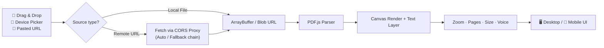

<div align="center">
<!-- ═══════════════════════════════════════════════════════════════════════ -->
<!--                          HEX PDF STUDIO — README                        -->
<!-- ═══════════════════════════════════════════════════════════════════════ -->


<!-- ░░ ANIMATED HEADER ░░ -->
<a href="https://hexsleuth.github.io/HEX-PDF-Studio/">
  
</a>

<!-- ░░ TYPING ANIMATION ░░ -->
<a href="https://hexsleuth.github.io/HEX-PDF-Studio/">
  
</a>

<br/>

<!-- ░░ REALTIME BADGES ░░ -->
<p>
  <a href="https://hexsleuth.github.io/HEX-PDF-Studio/"></a>
  
  
</p>

<p>
  
  
  
  
  
  
</p>

<p>
  
  
  
  
  
  
  
  
</p>

</div>

<!-- ░░ ANIMATED DIVIDER ░░ -->


<div align="center">

### 🧭 `No document` → `Tap ☰ to open a PDF`

**A single‑page, serverless PDF reader that lives entirely in your browser.**
Drag & drop a file, pick one from your device, or paste a link — cross‑origin fetching is handled automatically by free CORS proxies. No uploads. No accounts. No backend.

</div>

<!-- ░░ ANIMATED DIVIDER ░░ -->


## ✨ Features

<table>
  <tr>
    <td width="50%" valign="top">
      <h3>📂 Open Anything, Any Way</h3>
      <ul>
        <li>🖱️ <b>Drag &amp; drop</b> a PDF anywhere on the page</li>
        <li>📱 <b>Open from device</b> with the native file picker</li>
        <li>🔗 <b>Paste a URL</b> — remote PDFs just work</li>
        <li>🛡️ <b>Free CORS proxies</b> auto‑route blocked cross‑origin requests</li>
      </ul>
    </td>
    <td width="50%" valign="top">
      <h3>🔍 Read &amp; Navigate</h3>
      <ul>
        <li>🔎 <b>Zoom control</b> — precise, smooth, remembers state</li>
        <li>📄 <b>Page counter</b> — <code>1 / 1</code> style live indicator</li>
        <li>📐 <b>Size readout</b> — instantly see the document weight</li>
        <li>☰ <b>Collapsible sidebar</b> — built for small screens</li>
      </ul>
    </td>
  </tr>
  <tr>
    <td width="50%" valign="top">
      <h3>🗣️ Voice</h3>
      <ul>
        <li>🔊 <b>Text‑to‑speech</b> powered by the Web Speech API</li>
        <li>🌍 Loads available system voices automatically</li>
        <li>⏯️ Play / pause document read‑aloud</li>
      </ul>
    </td>
    <td width="50%" valign="top">
      <h3>⚡ Status &amp; Telemetry</h3>
      <ul>
        <li>🟢 <b>Server</b> status indicator</li>
        <li>🌐 <b>Proxy</b> mode (<code>Auto</code>) at a glance</li>
        <li>📊 Live <b>Pages</b>, <b>Size</b>, <b>Zoom</b> metrics</li>
        <li>🧩 Fully <b>offline‑capable</b> UI shell</li>
      </ul>
    </td>
  </tr>
</table>

<div align="center">

| 🎯 Metric | 📋 Live Value |
| :--- | :--- |
| **Server** | `offline` (static site — by design) |
| **Pages** | `0` → `n` on load |
| **Size** | `—` → real file size |
| **Zoom** | `100%` default |
| **Proxy** | `Auto` |
| **Server URL** | `http://localhost:8080` (optional local bridge) |

</div>

<!-- ░░ ANIMATED DIVIDER ░░ -->


## 🚀 Quick Start

### 1️⃣ Just use it (no install)

```text
https://hexsleuth.github.io/HEX-PDF-Studio/
```

2️⃣ Run it locally

```bash
# Clone
git clone https://github.com/hexsleuth/HEX-PDF-Studio.git
cd HEX-PDF-Studio

# Serve (any static server works)
python3 -m http.server 8080
#   → http://localhost:8080
```

Why a server? Opening index.html via file:// can block module scripts and CORS fetches. A one‑liner static server avoids that entirely.

3️⃣ Use it as an iframe / embed

```html
<iframe
  src="https://hexsleuth.github.io/HEX-PDF-Studio/"
  title="HEX PDF Studio"
  width="100%"
  height="720"
  style="border:0;border-radius:16px;"
  loading="lazy"
  allow="clipboard-read; clipboard-write">
</iframe>
```

<!-- ░░ ANIMATED DIVIDER ░░ -->


🧠 How It Works



Key ideas

· 🧩 Zero backend — GitHub Pages hosts everything statically.
· 🛡️ Privacy first — documents are parsed in‑memory; nothing is uploaded.
· 🔁 Graceful fallback — proxy chain rotates when a host blocks CORS.
· ♿ Accessible — semantic controls, keyboard‑friendly menu, voice output.

<!-- ░░ ANIMATED DIVIDER ░░ -->


📱 Mobile‑Friendly Interface

<div align="center">

Breakpoint Layout Behavior
📱 < 640px Single column ☰ hamburger sidebar, full‑bleed canvas, touch‑scroll zoom
📲 640–1024px Compact two‑pane Sidebar overlays content
🖥️ > 1024px Full workspace Persistent sidebar + toolbar

</div>

· 👆 Touch gestures: pinch‑to‑zoom, momentum scrolling, tap targets ≥ 44px
· 🌗 Responsive typography with clamp() — no horizontal scroll
· 🔒 Safe‑area insets respected on notched devices

<!-- ░░ ANIMATED DIVIDER ░░ -->


⌨️ Shortcuts

Keys Action
<kbd>☰</kbd> / <kbd>M</kbd> Toggle sidebar
<kbd>O</kbd> Open PDF from device
<kbd>U</kbd> Paste a URL
<kbd>+</kbd> / <kbd>−</kbd> Zoom in / out
<kbd>0</kbd> Reset zoom to 100%
<kbd>←</kbd> / <kbd>→</kbd> Previous / next page
<kbd>Space</kbd> Play / pause Voice
<kbd>Esc</kbd> Close dialog

<!-- ░░ ANIMATED DIVIDER ░░ -->


🗂️ Project Structure

```text
HEX-PDF-Studio/
├── index.html          # Single-page shell (☰ sidebar, viewer, toolbar)
├── css/
│   └── styles.css      # Responsive layout, animations, dark UI
├── js/
│   ├── app.js          # Bootstrap + UI wiring
│   ├── viewer.js       # PDF.js render, zoom, page nav
│   ├── fetch.js        # URL input + CORS proxy fallback chain
│   └── voice.js        # Web Speech API read-aloud
├── assets/
│   └── icons/          # Favicons & UI glyphs
└── README.md
```

<!-- ░░ ANIMATED DIVIDER ░░ -->


🛠️ Tech Stack

<div align="center">

Layer Technology
Markup HTML5 semantic + ARIA
Styling CSS3 — Grid, Flexbox, clamp(), custom properties, keyframe animations
Logic Vanilla JavaScript (ES2020+, no framework)
PDF Engine PDF.js
Speech Web Speech API (speechSynthesis)
Networking Fetch API + public CORS proxies
Hosting GitHub Pages (CDN‑backed, HTTPS)

</div>

<!-- ░░ ANIMATED DIVIDER ░░ -->


🗺️ Roadmap

☑ Drag & drop PDF loading
☑ Device file picker
☑ URL loading with automatic CORS proxies
☑ Zoom, page count, file size, proxy status
☑ Voice read‑aloud
☑ Fully responsive mobile UI
☐ 🎨 Text highlighting & annotations
☐ 🔖 Bookmarks and outline navigation
☐ 🌙 Light / dark theme toggle
☐ 💾 Remember last opened document (IndexedDB)
☐ 🖨️ Print & export current page as image

<!-- ░░ ANIMATED DIVIDER ░░ -->


🤝 Contributing

Contributions are what make open source wonderful. 🎉

```bash
# 1. Fork the repo
# 2. Create your branch
git checkout -b feature/amazing-feature

# 3. Commit your changes
git commit -m "feat: add amazing feature"

# 4. Push and open a PR
git push origin feature/amazing-feature
```

<div align="center">


</div>

Guidelines: keep PRs focused · match existing code style · test on mobile widths · no new dependencies without discussion.

<!-- ░░ ANIMATED DIVIDER ░░ -->


🐛 Reporting Issues

Found a PDF that won't load, a broken proxy, or a layout glitch on your phone?

➡️ Open an issue with:

1. Browser + OS + version
2. Steps to reproduce
3. Console output (if any)
4. Optional: the failing URL or file type

<!-- ░░ ANIMATED DIVIDER ░░ -->


📜 License

Distributed under the MIT License — see LICENSE for details.

<div align="center">


</div>

<!-- ░░ ANIMATED DIVIDER ░░ -->


⭐ Star History

<div align="center">

<a href="https://star-history.com/#hexsleuth/HEX-PDF-Studio&Date">
  
</a>

</div>

<!-- ░░ ANIMATED DIVIDER ░░ -->


<div align="center">

💙 Built with vanilla web tech, for everyone.

<a href="https://hexsleuth.github.io/HEX-PDF-Studio/">
  
</a>


<a href="https://hexsleuth.github.io/HEX-PDF-Studio/">
  
</a>

<sub>⚠️ Free public CORS proxies are best‑effort and may rate‑limit. For production, self‑host a proxy.</sub>

</div>
